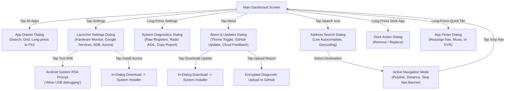

# Minimal Car Launcher — Product Specification & Functional Architecture Guide

This document is a comprehensive functional and UI/UX blueprint of the **Minimal Car Launcher**. It details the application's layout, visual hierarchy, core functions, and every sub-feature. It serves as an exhaustive functional specification for creating this exact automotive dashboard application, focusing entirely on design, user experience, capabilities, and system interactions without implementation code.

---

## 1. Application Philosophy & Design Principles

1. **Distraction-Free Automotive Cockpit**:
   - Built exclusively for fixed-landscape automotive touchscreen displays (optimized for 1280×720 at 160 dpi).
   - High-contrast elements, high legibility typography, and oversized touch targets (minimum 60–80 dp) to ensure rapid muscle-memory operation while operating a vehicle.
2. **True Low-Footprint Architecture**:
   - Engineered specifically for resource-constrained Android head units (1–2 GB physical RAM with tight memory headroom).
   - Zero background polling loops when features are not actively visible. All telemetry and background services suspend when their respective dialogs or widgets are inactive.
3. **Cockpit Dual-Theme Support**:
   - **Obsidian Dark Mode (Night)**: Pure deep-slate backgrounds (`#0A0E17`), subtle borders, cyan/amber illumination to eliminate night glare.
   - **High-Contrast Light Mode (Day)**: Crisp daylight-readable contrast designed to counter direct sunlight reflections through windshields.

---

## 2. Master Screen Layout Structure

The main dashboard utilizes a balanced **3-Column Landscape Split Layout** across the entire 1280×720 display canvas:

```
+-------------------------------------------------------------------------------------------------------+
|  LEFT COLUMN (Weight: 1.0)       |      CENTER COLUMN (Aspect 1:1)       |  RIGHT COLUMN (Weight: 1.0)   |
|                                  |                                       |                               |
|  [ Digital Chronometer Widget ]  |    /-----------------------------\    |  [ DVR / Camera Quick Tile ]  |
|  - Time, Running Secs, Date      |   /                               \   |  [ ZLink CarPlay / AA Tile ]  |
|                                  |  |   Circular Moving Map Portal    |  |  [ Primary Navigation Tile ]  |
|  [ Radio Tuner Station Widget ]  |  |   - Heading-up Map / Bearing    |  |  [ Media / Music Tile ]       |
|  - Freq, Seek, Presets 1-6       |  |   - Speedometer (KM/H / MPH)    |                               |
|                                  |  |   - Integrated Route Nav & Pin  |                               |
|                                  |   \                               /   |                               |
|  [ Left Bottom Dock ]            |    \-----------------------------/    |  [ Right Bottom Dock ]        |
|  - All Apps Trigger              |                                       |  - About & Update Checker     |
|  - Pinned Favorites + Add Button |                                       |  - Settings & Diagnostics     |
+-------------------------------------------------------------------------------------------------------+
```

---

## 3. Detailed Component & Functional Breakdown

### 3.1 Center Column: Circular Moving Map Portal & Telemetry Hub

The centerpiece of the cockpit is a circular masked viewport that combines navigation, telemetry, and orientation into a unified visual instrument.

#### Core Sub-Functions:
1. **Live Moving Road Map**:
   - Renders OpenStreetMap vector tiles centered dynamically on the vehicle's GPS position.
   - Auto-rotates according to true GPS bearing ("Heading-Up" orientation) so the road ahead is always pointing upward.
2. **Rotational Compass & Cardinal Direction**:
   - Integrated floating compass ribbon indicating heading degrees (`0°–359°`).
   - Cardinal orientation indicator displaying one of the 8 dynamic headings (`N`, `NE`, `E`, `SE`, `S`, `SW`, `W`, `NW`).
3. **Automotive Digital Speedometer Overlay**:
   - Prominent numerical speed readout overlaid at the center-bottom of the portal.
   - **Unit Toggle Button**: Tap directly on the speed unit to toggle instantly between **KM/H** and **MPH** (persisted across sessions).
   - **GPS Fix Status Dot**:
     - *Green*: Active GPS lock with valid location fixes.
     - *Amber / Red*: Acquiring satellites or hardware GPS unavailable.
4. **Autonomous In-App Route Navigation**:
   - **Address Search Trigger**: Dedicated search icon in the portal header.
   - **Search Autocomplete Modal**:
     - Interactive search dialog with instant live place geocoding as the driver types.
     - Result list with street names, suburbs, and distance.
   - **Route Calculation & Turn Guidance**:
     - Generates optimal vehicular driving route and renders an illuminated polyline onto the moving map.
     - Automatically zooms and frames the destination pin.
   - **Active Navigation Mode**:
     - Displays destination name and arrival distance.
     - Provides an illuminated **"Stop Navigation"** button to cancel the route guidance at any time.
5. **Fullscreen Navigation Launcher Shortcut**:
   - Tapping the map area outside controls launches the designated primary external navigation app (e.g. Google Maps, Waze, OsmAnd).

---

### 3.2 Left Column (Top): Digital Chronometer Widget

A clean, modern time-and-date automotive instrument.

#### Core Sub-Functions:
1. **Time Display**: High-contrast 24-hour or 12-hour digital time with oversized numerals for effortless glances.
2. **Running Seconds Indicator**: Discreet running seconds counter providing immediate confirmation that the system interface is active and fluid.
3. **Localized Automotive Date**: Formatted date display (e.g. `Tuesday, Oct 27`) synced with vehicle/system clock.

---

### 3.3 Left Column (Middle): Radio Station & Hardware Tuner Widget

Directly interfaces with the head unit's Nowada (NWD) FM/AM hardware tuner service without needing to leave the dashboard.

#### Core Sub-Functions:
1. **Live Frequency Display**: Shows current tuner frequency formatted in MHz (FM: `87.50–108.00 MHz`) or kHz (AM: `531–1620 kHz`).
2. **Radio Power / Audio State**: Real-time indicator showing whether the tuner hardware audio stream is active or in standby.
3. **Live RDS Station Metadata**: Text banner displaying Radio Data System (RDS) program service name (`PS`) and radio text (`RT`) when broadcasted by stations.
4. **Step Seek Controls**:
   - `<< Prev Seek`: Sends backward seek command to the hardware tuner.
   - `Next Seek >>`: Sends forward seek command to the hardware tuner.
5. **Quick-Recall Preset Bank (Slots 1–6)**:
   - Six persistent preset station pill buttons.
   - **Single-Tap**: Immediately tunes the hardware radio to the saved frequency.
   - **Long-Press**: Saves the current active playing frequency into the selected preset slot with haptic/visual confirmation.
6. **Native Radio App Launcher**: Tapping the station header opens the head unit's full-screen stock radio application.

---

### 3.4 Left Column (Bottom): Left Bottom Dock (App Launcher & Favorites)

An accessible quick-launch dock with touch targets enlarged to 80dp to prevent driving misclicks.

#### Core Sub-Functions:
1. **All Apps Drawer Button**: Oversized grid icon that triggers the full application drawer modal.
2. **Pinned Favorites Bar**:
   - Horizontal scrolling shelf housing user-customized app shortcuts.
   - **Single-Tap**: Instantly launches the selected app.
   - **Long-Press**: Opens the **Dock Action Dialog**:
     - *Remove*: Deletes the app from the quick dock.
     - *Replace*: Opens the App Picker to swap the icon with another installed app.
3. **Add App (`+`) Button**:
   - Visible when the dock has room (up to maximum allowed dock items).
   - Opens the App Picker filtered to show only unpinned apps.

---

### 3.5 Right Column (Top & Middle): Quick-Launch Smart Cards

A 2×2 grid of large, tactile automotive utility tiles representing primary in-car functions.

#### The 4 Core Smart Cards:
1. **DVR / Dashcam**:
   - *Single-Tap*: Launches the car's connected front/rear dashcam camera stream.
   - *Long-Press*: Opens the App Picker to customize which dashcam app is triggered.
2. **ZLink (CarPlay & Android Auto)**:
   - Dedicated tile for wireless and wired Apple CarPlay / Android Auto projection.
   - Dynamically labels itself based on installed projection package (`ZLink`, `AutoKit`, `TLink`).
3. **Primary Navigation**:
   - *Single-Tap*: Launches the driver's preferred navigation suite.
   - *Long-Press*: Opens the App Picker to reassign the default navigation application.
4. **Media / Music**:
   - *Single-Tap*: Launches default music player (e.g. Spotify, Apple Music, stock music).
   - *Long-Press*: Opens the App Picker to reassign the default music application.

---

### 3.6 Right Column (Bottom): Utility Action Dock

Houses system tools, software updates, and configuration controls.

#### Core Sub-Functions:
1. **About & Updates Button**:
   - Displays dynamic badge notification when a newer release is detected on GitHub.
   - *Single-Tap*: Opens the **About & Software Update Dialog**.
2. **Settings Button**:
   - *Single-Tap*: Opens the **Custom Launcher Settings Dialog**.
   - *Long-Press*: Opens the **System & Radio Diagnostics Inspector**.

---

### 3.7 Custom Launcher Settings Dialog

A dedicated settings center addressing head unit-specific constraints (disabled Google services, app store access, and resource consumption).

#### Core Sub-Functions:
1. **Live Ultra-Lightweight Hardware Usage Monitor**:
   - **Real-Time CPU Usage**: Live percentage readout with active core count indicator, computed via `/proc/stat` delta.
   - **Real-Time RAM Usage**: Memory consumption display (`Used / Total GB`, percentage meter, and free MB) calculated through native Android memory info.
   - **Zero Overhead**: Active *only* while the dialog is open (polled every 2s). Pauses completely upon dismissal so zero CPU or memory is wasted during normal vehicle operation.
2. **Android System Settings Shortcut**:
   - Direct button jumping to the head unit's native Android Settings (Wi-Fi, Bluetooth, Sound, Display).
3. **Google Services & ADB Control Section**:
   - **Live Status Pills**: Displays whether root access is present and the connection state of the local ADB daemon (Port 5555 open/closed).
   - **Individual Package Toggles**:
     - *Google Services Framework (`com.google.android.gsf`)*
     - *Google Play Services (`com.google.android.gms`)*
     - *Google Play Store (`com.android.vending`)*
   - **Bulk Action Buttons**: "Enable All" and "Disable All".
   - **Execution Engine**:
     - Automatically routes commands through **Local ADB Loopback** (`localhost:5555`), **Root shell** (`su`), or **System API**.
   - **Test / Connect ADB Button**:
     - Connects to the local daemon and triggers the Android system **"Allow USB debugging?"** authorization popup directly on the screen.
   - **Copy ADB Command Buttons**:
     - Copy button next to each package allowing the driver to copy the exact `pm enable` or `pm disable-user` command to clipboard for manual PC execution if desired.
4. **Aurora Store Integration (Open-Source Google Play)**:
   - Status pill indicating whether Aurora Store is installed and its version.
   - **One-Tap Download & Install**:
     - Fetches latest stable APK release from F-Droid repository (with official GitLab as automatic fallback).
     - Live in-dialog download progress bar.
     - Automatically opens the Android Package Installer prompt upon download completion.
   - **Open Aurora Store Shortcut**: Appears once installed for one-tap store browsing without needing Google Play Services.

---

### 3.8 About, In-App Updater & Cloud Diagnostics Dialog

The maintenance and feedback hub of the application.

#### Core Sub-Functions:
1. **In-App GitHub Updater**:
   - Communicates directly with the project's GitHub Releases API.
   - Automatically compares installed semantic version against the latest remote release tag.
   - Renders update changelog and release notes.
   - **"Download & Install"**: Downloads update directly to cache with progress bar and prompts the system installer.
2. **Cockpit Theme Toggle**:
   - Switch between **Obsidian Dark Mode** and **Daylight High-Contrast Light Mode**.
3. **Encrypted Cloud Diagnostics & Feedback Sub-system**:
   - **Comprehensive Data Gathering**: Packages motherboard, SoC platform, Linux kernel version, real Android SDK, display resolution, MCU firmware revision, and Radio binder registers into a secure diagnostic report.
   - **User Note Field**: Allows the driver to type an optional feedback message, bug explanation, or request.
   - **One-Tap Cloud Upload**: Encrypts and transmits the report and user notes directly to the project's repository backend for developer triage.
4. **Full System Info Button**:
   - Opens the raw Diagnostic Terminal modal for complete on-device inspection.

---

### 3.9 System Diagnostics Inspector Dialog

A full-screen terminal-style diagnostic inspector designed for automotive reverse engineering.

#### Core Sub-Functions:
1. **Raw System Register Dump**: Displays all detected system properties, Allwinner platform keys, and MCU settings (`Settings.System`).
2. **Radio Binder Telemetry**: Shows active AIDL binder descriptors, frequency limits, and audio routing channels.
3. **Memory & Kernel Breakdown**: Details raw `/proc/meminfo` accounting lines, verifying real vs spoofed memory counters.
4. **Copy Report**: Copies the entire structured diagnostic report to the clipboard.

---

## 4. Interaction Flows & State Transitions



---

## 5. Summary Blueprint Checklist for Replication

To recreate this exact application, implement:
- [x] Fixed landscape 1280×720 3-column cockpit grid.
- [x] Circular moving map portal with heading-up rotation, compass, unit-toggleable speedometer, and address routing.
- [x] Dual-theme color system (Obsidian night mode & daylight high-contrast mode).
- [x] Hardware FM/AM tuner controller widget with RDS text and 6 quick-recall presets.
- [x] High-touch-target bottom docks with customizable pinned apps.
- [x] Quick-launch cards for DVR, CarPlay/AA (ZLink), Navigation, and Music.
- [x] Full-screen App Drawer with instant search filtering.
- [x] On-demand, ultra-lightweight CPU & RAM hardware monitor (active only while settings are visible).
- [x] Google services management via Local ADB loopback (`localhost:5555`) and root.
- [x] Integrated Aurora Store fetcher and installer.
- [x] In-app GitHub release updater with automatic download progress and installation.
- [x] Cloud diagnostics reporter capturing hardware, MCU, and radio telemetry with user feedback notes.
- [x] Full raw system inspector for head unit diagnostics and reverse engineering.
